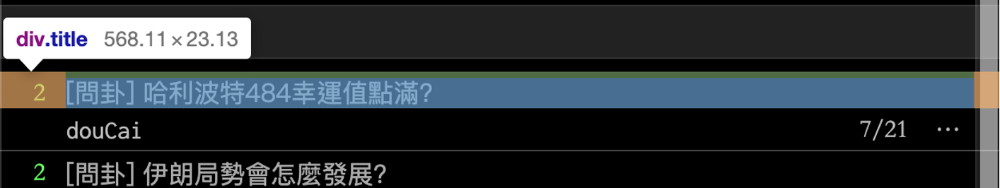
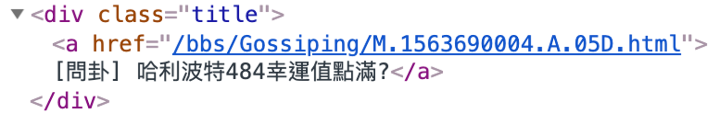

# HTML Basic

## Quick View

[https://www.ptt.cc/bbs/Gossiping/index.html](https://www.ptt.cc/bbs/Gossiping/index.html)

Enter this on browser\
`view-source:https://www.ptt.cc/bbs/Gossiping/index.html`

## What is HTML

- HTML (HyperText Markup Language)
- A markup language
- Used to define structure and content of a web page.

## Tag and Attribute

```html
<tag attribute="something"> content </tag>
```

## HTML Example
```html
<!DOCTYPE html>
<html>
<head>
    <title>My First Web Page</title>
</head>
<body>
    <h1>Hello World!</h1>
    <p>This is a paragraph.</p>
</body>
</html>
```

### Simple Example





### Common HTML Elements (tags)

| Element | Description | Example |
|--------|-------------|---------|
| `<html>` | Root element of the HTML document | `<html>...</html>` |
| `<head>` | Page info (not shown on screen) | `<title>`, `<meta>` |
| `<body>` | Main content: this is what crawlers focus on | `<h1>`, `<p>`, `<div>` |
| `<h1>`~`<h6>` | Headings (h1 is largest) | `<h1>Title</h1>` |
| `<p>` | Paragraph | `<p>This is text.</p>` |
| `<a>` | Hyperlink | `<a href="https://example.com">Click me</a>` |
| `` | Image | `` |
| `<div>` / `<span>` | Containers for grouping content | `<div>Block</div>` |
| `<table>` | Table (commonly used for prices, rankings, etc.) | `<table>...</table>` |

## HTML Practice

### Sample Code
[https://github.com/uuboyscy/course-html/tree/master](https://github.com/uuboyscy/course-html/tree/master)

### Practice with VS Code and a Browser

Use [VSCode](https://code.visualstudio.com/) to write HTML and a browser to view the result.

1. Create a folder for your practice files and open it in VSCode.
2. Create a file named `index.html`.
3. Copy the HTML example above into the file and save it.
4. Open `index.html` in your browser (for example, drag the file into a browser tab).
5. Change anything in VSCode, save the file, and refresh the browser to see the changes.

For this exercise, you only need an editor and a browser. No server or extensions are required.
