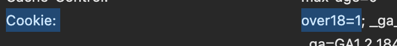

# Web Crawler with Cookies

Cookies let a website remember information between requests. For example, PTT's **Gossiping** board uses an age-confirmation page before showing its articles.

After you confirm that you are over 18, PTT uses a cookie named `over18` with the value `1` to remember your choice. This is an age-confirmation cookie, not a login credential.

## Find the Cookie in Chrome

1. Open [PTT Gossiping](https://www.ptt.cc/bbs/Gossiping/index.html) in Chrome and complete the age confirmation if you are eligible.
2. Open DevTools → **Network**, then refresh the page.
3. Select the request for the board page and check **Headers** → **Request Headers** → **Cookie**. Look for `over18=1`.



## Send the Cookie with requests

Pass a dictionary to the `cookies` parameter. The `headers` dictionary follows the example in the previous lesson.

```python
import requests
from bs4 import BeautifulSoup

headers = {
    "User-Agent": "Mozilla/5.0 (Macintosh; Intel Mac OS X 10_15_7) AppleWebKit/537.36 (KHTML, like Gecko) Chrome/156.0.0.0 Safari/537.36"
}

url = "https://www.ptt.cc/bbs/Gossiping/index.html"
cookies = {"over18": "1"}

response = requests.get(url, headers=headers, cookies=cookies, timeout=10)
response.raise_for_status()
soup = BeautifulSoup(response.content, "html.parser")

for link in soup.select("div.title a"):
    print(link.get_text(strip=True))
```
